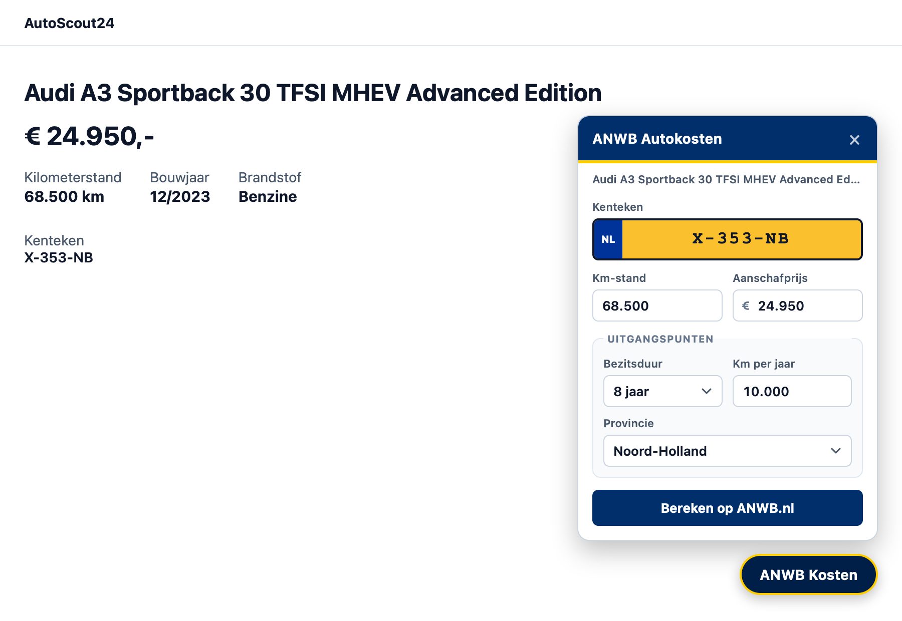
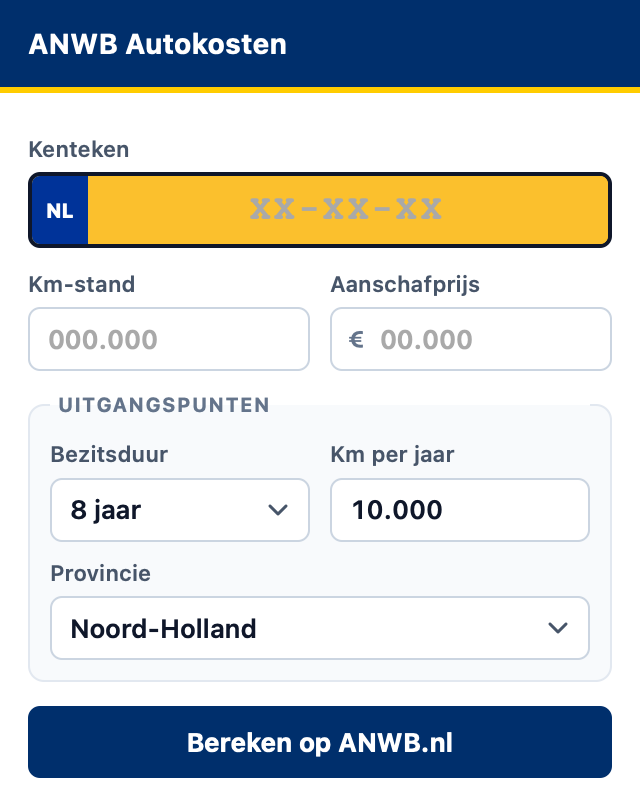

# Autokosten Berekenaar

Een Safari-extensie die occasions op **AutoScout24.nl** uitleest (kenteken, kilometerstand en vraagprijs) en automatisch de **ANWB Autokosten Calculator** invult, zodat je in één klik de werkelijke maandlasten van een auto ziet.

<p align="center">
  
</p>

> **Let op:** dit is een persoonlijk, onofficieel project. Het is niet verbonden aan, en wordt niet ondersteund door, AutoScout24 of ANWB. Zie [Disclaimer](#disclaimer).

---

## Wat het doet

1. **Leest de advertentie uit.** Kenteken, kilometerstand en vraagprijs worden van de AutoScout24-pagina gehaald. Kentekens worden herkend aan de hand van alle Nederlandse RDW-sidecodes (1 t/m 14), via `__NEXT_DATA__`, JSON-LD, specificatietabellen en de advertentietekst. De prijs wordt bewust *inclusief* BTW gekozen: ex-BTW- en doorgestreepte prijzen worden genegeerd.

2. **Twee identieke ingangen.** Een zwevende knop rechtsonder op de advertentiepagina, en het extensie-icoon in de Safari-werkbalk. Beide tonen exact hetzelfde formulier, zodat ze niet uit elkaar kunnen lopen.

3. **Instelbare uitgangspunten.** Bezitsduur, kilometers per jaar en provincie pas je direct in het formulier aan. Ze worden lokaal opgeslagen en bij de volgende berekening hergebruikt.

4. **Doorloopt de ANWB-rekentool.** De extensie vult het kenteken in, kiest de standaarduitvoering, zet de aanschafdatum op de huidige maand, en vult kilometerstand, aanschafprijs en jouw uitgangspunten in. Daarna word je doorgestuurd naar het resultaat met de maandelijkse kosten.

<p align="center">
  
</p>

## Installeren

De extensie is niet ondertekend en staat niet in de App Store, dus je laadt hem in Safari als tijdelijke extensie.

### 1. Ontwikkelaarsfuncties aanzetten

1. Open **Safari** en ga naar **Safari › Instellingen…** (`⌘,`).
2. Open het tabblad **Geavanceerd**.
3. Vink **"Toon functies voor webontwikkelaars"** aan.

### 2. Niet-ondertekende extensies toestaan

1. Open in de menubalk het menu **Ontwikkel**.
2. Kies **"Niet-ondertekende extensies toestaan"** en bevestig met je wachtwoord.

### 3. Extensie laden

1. Kies in het menu **Ontwikkel** voor **"Voeg tijdelijke extensie toe…"**.
2. Selecteer de map met `manifest.json` (de hoofdmap van deze repo).
3. Klaar — de extensie is actief.

> Safari vergeet tijdelijke extensies zodra je hem afsluit. Na een herstart van Safari laad je hem opnieuw. Voor dagelijks gebruik kun je er beter een echte app van maken — zie hieronder.

### Een blijvende installatie maken

Met de tijdelijke-extensie-methode hierboven moet je de extensie na elke herstart van Safari opnieuw laden. Wil je dat niet, dan kun je deze repo omzetten in een echte macOS-app die Safari definitief installeert. Dat heeft twee voordelen: de extensie blijft staan, en je kunt **"Niet-ondertekende extensies toestaan"** daarna weer uitzetten.

Je hebt daar **volledige Xcode** voor nodig (niet alleen de Command Line Tools), omdat het `safari-web-extension-converter` gebruikt.

1. Installeer Xcode via de App Store, en zet daarna de toolchain goed:

   ```bash
   sudo xcode-select -s /Applications/Xcode.app
   sudo xcodebuild -runFirstLaunch
   ```

2. Genereer het Xcode-project:

   ```bash
   ./scripts/make-safari-app.sh
   ```

3. Open het gegenereerde project, kies bij **Signing & Capabilities** je team (een gratis Apple ID is genoeg voor eigen gebruik), en druk op **Run** (`⌘R`).

4. Zet de extensie aan in **Safari › Instellingen › Extensies**.

Het Xcode-project komt **naast** deze repo te staan (in `../autokosten-berekenaar-safari`), niet erin. Dat is bewust: de converter scant de extensiemap op bestanden, en zijn eigen uitvoer daarin schrijven kan verwarring geven. Het project verwijst naar de bestanden in deze repo in plaats van ze te kopiëren, dus je kunt blijven doorwerken in deze map en daarna in Xcode opnieuw bouwen.

> **Verspreiden naar anderen** is een grotere stap: dan heb je een betaald Apple Developer-account nodig ($99 per jaar) om de app te ondertekenen en te notariseren. Zonder dat kunnen anderen de app niet zonder waarschuwing installeren.

## Gebruik

1. Open een advertentie op `autoscout24.nl/aanbod/…`.
2. Klik op **ANWB Kosten** rechtsonder, of op het extensie-icoon in de werkbalk.
3. Controleer de uitgelezen gegevens en pas zo nodig de uitgangspunten aan.
4. Klik op **Bereken op ANWB.nl**. Er opent een nieuw tabblad waarin de rekentool automatisch wordt doorlopen.

Staat het kenteken niet in de advertentie? Dan laat het formulier dat weten en kun je het zelf invullen — het kenteken is het enige dat ANWB nodig heeft om de auto op te zoeken.

## Hoe het werkt

```
manifest.json          Manifest V3 (Safari / WebExtensions)
background.js          Service worker: tab- en message-beheer
utils/
  kenteken.js          RDW-sidecode validatie, opmaak en extractie
  dom-utils.js         React-bewuste formulierhulpjes voor de ANWB-tool
  calculator-form.js   Het gedeelde formulier (popup + zwevende knop)
content/
  autoscout.js         Leest de advertentiepagina uit
  form.css             Styling van het gedeelde formulier
  autoscout.css        Styling van de zwevende knop
  anwb.js              Automatiseert de ANWB-rekentool
  anwb.css             Voortgangsbalk tijdens het automatiseren
popup/                 Werkbalk-popup (rendert hetzelfde formulier)
scripts/
  generate-icons.js    Genereert de PNG-iconen
  make-safari-app.sh   Zet de extensie om naar een echte macOS-app
```

Een paar keuzes die het gedrag van de ANWB-tool verklaren, allemaal tegen de echte site geverifieerd:

- **React-bewaarde invoervelden.** De rekentool gebruikt React Hook Form. Alleen `.value` zetten en een `change`-event sturen is niet genoeg; de interne value tracker van React moet ook bijgewerkt worden. Dat regelt `setInputValue`.
- **De eerste klik wordt altijd afgewezen.** React Hook Form weigert een submit die binnenkomt terwijl het formulier nog aan het settelen is, ook als het veld al een geldige waarde heeft. Opnieuw klikken *zonder opnieuw te typen* lukt wel. Daarom vult de automatisering elk veld één keer en klikt daarna bij elke ronde opnieuw.
- **Velden verschijnen in golven.** Bezitsduur, kilometers per jaar en provincie bestaan pas in de DOM nadat jaar, maand, prijs en kilometerstand geldig zijn. De automatisering wacht daarom per veld tot het bestaat.
- **De automatisering is een lus, geen vaste volgorde.** Ze kijkt welk scherm zichtbaar is en rondt dat af, zodat ze herstelt als ANWB een scherm overslaat (bijvoorbeeld als er maar één uitvoering is) of van volgorde verandert.

## Privacy

De extensie verstuurt niets naar de ontwikkelaar. Er is geen server, geen analytics en geen account. Alle gegevens blijven in je browser:

- Het kenteken, de kilometerstand en de prijs worden van de pagina gelezen en naar `anwb.nl` gestuurd, omdat de rekentool daar nu eenmaal om vraagt.
- Je uitgangspunten worden lokaal opgeslagen in `chrome.storage.local`, zodat je ze niet elke keer opnieuw hoeft in te vullen.
- Er worden geen gegevens verzameld, bewaard of gedeeld.

## Ontwikkelen

Vereist Node.js 18 of nieuwer.

```bash
npm install
npm test              # alles: unit + UI + live end-to-end
npm run test:unit     # snel en offline: kenteken, extractie, dom-utils, manifest
npm run test:ui       # laadt de echte popup en zwevende knop in WebKit
npm run test:e2e      # doorloopt de echte ANWB-rekentool in WebKit
```

De UI- en end-to-end tests draaien in **WebKit**, de engine van Safari, via Playwright. Daardoor testen ze gedrag dat er in Chrome net anders uitziet — bijvoorbeeld dat WebKit padding op een native `<select>` negeert.

De UI-tests laden de **echte** bestanden uit deze repo, niet een kopie. Ze controleren onder andere dat het manifest elk script laadt dat de code nodig heeft, dat alle formuliervelden even hoog zijn, en dat het openen van een tab goed gaat in alle drie de contexten (popup, content script, en een background die niet reageert).

De end-to-end test heeft netwerktoegang nodig en raakt de echte ANWB-site. Die is niet geschikt voor CI.

> De kenteken-lookup van ANWB geeft met enige regelmaat een serverfout (504). De automatisering probeert het dan opnieuw, waardoor een berekening soms wat langer duurt.

## Disclaimer

Dit is een persoonlijk project en **geen officieel product**. Het is niet verbonden aan, goedgekeurd door of ondersteund door AutoScout24 of ANWB. Alle merknamen zijn eigendom van hun respectievelijke eigenaren.

De extensie leest pagina's van AutoScout24 en vult formulieren op anwb.nl in. Het automatiseren van een website kan in strijd zijn met de gebruiksvoorwaarden van die site. Gebruik het daarom voor je eigen, persoonlijke gebruik en met mate. De auteur is niet aansprakelijk voor eventuele gevolgen.

De berekende bedragen komen volledig van ANWB en zijn een indicatie. Controleer altijd de officiële cijfers voordat je een beslissing neemt.

## Licentie

[MIT](LICENSE)
